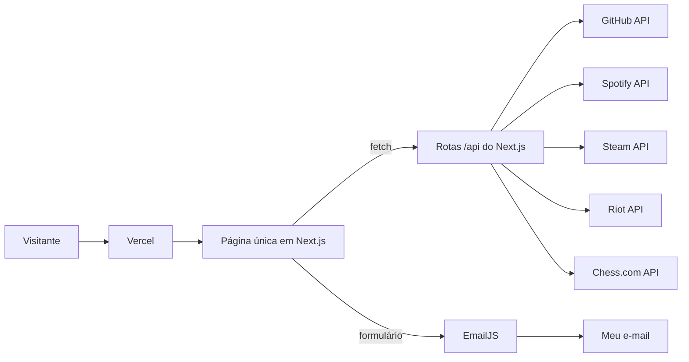

# Gustavo Vieira · Portfólio

<!-- Substitua pelo print da tela inicial depois do deploy -->
<!--  -->

Portfólio profissional em uma página, com identidade visual neon anos 80 e objetos low-poly. Apresenta minha trajetória, habilidades, projetos, experiências e formas de contato, em português e inglês.

Projeto desenvolvido para o **Laboratório 01 — Portfólio Profissional** da disciplina **Desenvolvimento e Integração de Aplicações Web (DIAW)**, Engenharia de Software, PUC Minas.

## Status do Projeto


## Índice

- [Links Úteis](#links-úteis)
- [Sobre o Projeto](#sobre-o-projeto)
- [Funcionalidades Principais](#funcionalidades-principais)
- [Tecnologias Utilizadas](#tecnologias-utilizadas)
- [Arquitetura](#arquitetura)
- [Instalação e Execução](#instalação-e-execução)
- [Deploy](#deploy)
- [Estrutura de Pastas](#estrutura-de-pastas)
- [Demonstração](#demonstração)
- [Testes](#testes)
- [Documentações utilizadas](#documentações-utilizadas)
- [Autores](#autores)
- [Contribuição](#contribuição)
- [Agradecimentos](#agradecimentos)
- [Licença](#licença)

## Links Úteis

- **Site publicado:** [https://SEU-PROJETO.vercel.app](https://SEU-PROJETO.vercel.app) <!-- atualizar após o deploy -->
- **Wireframes (Figma):** [link do Figma](https://www.figma.com/) <!-- atualizar -->
- **Repositório:** [github.com/vGustav1/portfolio](https://github.com/vGustav1/portfolio)

## Sobre o Projeto

O objetivo é apresentar minha trajetória como estudante de Engenharia de Software de forma moderna, acessível e com personalidade. O site é uma página única: a abertura é uma cidade animada ao pôr do sol, e ao rolar o conteúdo aparece sobre um fundo escuro, com um menu fixo que leva a cada seção.

Além das quatro seções pedidas no enunciado (Sobre mim, Projetos, Experiências e Contato), o portfólio tem uma seção de **Hobbies** com dados ao vivo de APIs de jogos e música, mostrando quem eu sou fora do código.

## Funcionalidades Principais

- **Menu de navegação** fixo, com destaque da seção visível e menu recolhível no celular.
- **Português e inglês** em todo o site, com a escolha salva no navegador.
- **Sobre mim** com resumo, formação e um **sistema solar interativo de habilidades**: cada tecnologia é um planeta em órbita; ao clicar, um painel mostra categoria, tempo de uso e projetos em que foi usada.
- **Projetos** em linha do tempo do mais antigo ao mais recente, cada um com nome, descrição, tecnologias, link do GitHub e GIF.
- **Repositórios recentes** carregados da API do GitHub.
- **Experiências** com filtro por tipo (profissional, acadêmica, open source, eventos).
- **Hobbies** com Spotify, Steam, League of Legends e Chess.com, com dados de reserva quando uma API não está configurada.
- **Contato** com ícones clicáveis (e-mail, WhatsApp, LinkedIn, GitHub) e formulário com validação e envio por e-mail via EmailJS.
- **Responsivo** do celular ao desktop, com respeito à preferência de "reduzir movimento" do sistema.

## Tecnologias Utilizadas

### Front-end

- **Framework:** Next.js 16 (App Router)
- **Biblioteca de UI:** React 19
- **Linguagem:** TypeScript 5
- **Estilização:** CSS puro com variáveis (sem framework de CSS)
- **E-mail:** EmailJS (`@emailjs/browser` 5)
- **Fontes:** Barlow Condensed, Chakra Petch e Share Tech Mono (Google Fonts)

### Back-end

- **Rotas de API do Next.js** (`app/api/*`), executadas no servidor da Vercel, para esconder as chaves das APIs externas.
- **APIs externas:** GitHub REST, Spotify Web API, Steam Web API, Riot Games API e Chess.com Published-Data API.
- Não há banco de dados: o conteúdo fica em `data/content.ts`.

### Mobile (Opcional)

Não se aplica: o site é responsivo e funciona no navegador do celular.

### Infraestrutura & DevOps

- **Hospedagem:** Vercel (plano gratuito), com deploy automático a cada push na branch `main`.
- **Controle de versão:** Git e GitHub.

## Arquitetura



- A página é gerada de forma estática e os componentes interativos rodam no navegador.
- Cada integração tem uma rota própria em `app/api/`, que guarda a resposta em cache por 10 minutos (1 hora no GitHub) e devolve dados de reserva se a API falhar.
- Os textos do site ficam em `lib/i18n.tsx` (interface) e `data/content.ts` (conteúdo), sempre em pares `{ pt, en }`.

## Instalação e Execução

### Pré-requisitos

- Node.js 20 ou superior
- npm 10 ou superior
- Git

### Variáveis de Ambiente

Copie `.env.example` para `.env.local` e preencha. Todas são opcionais: sem elas, o site funciona com dados de exemplo.

#### 1 Back-end (Spring Boot)

Não se aplica.

#### 2 Front-end (React, Vite)

Este projeto usa Next.js. Variáveis:

| Variável | Uso |
| --- | --- |
| `NEXT_PUBLIC_EMAILJS_SERVICE_ID` | Serviço de e-mail no EmailJS |
| `NEXT_PUBLIC_EMAILJS_TEMPLATE_ID` | Template do e-mail (usa `from_name`, `reply_to` e `message`) |
| `NEXT_PUBLIC_EMAILJS_PUBLIC_KEY` | Chave pública do EmailJS |
| `GITHUB_USERNAME` | Usuário do GitHub para os repositórios recentes |
| `GITHUB_TOKEN` | Opcional, aumenta o limite de requisições |
| `CHESS_USERNAME` | Usuário do Chess.com |
| `STEAM_API_KEY`, `STEAM_ID` | Chave e ID numérico da Steam (perfil público) |
| `SPOTIFY_CLIENT_ID`, `SPOTIFY_CLIENT_SECRET`, `SPOTIFY_REFRESH_TOKEN` | App do Spotify e refresh token com os escopos `user-read-currently-playing` e `user-read-recently-played` |
| `RIOT_API_KEY`, `RIOT_GAME_NAME`, `RIOT_TAG_LINE` | Chave da Riot e Riot ID (nome#tag) |
| `RIOT_REGION`, `RIOT_PLATFORM` | Padrão `americas` e `br1` |

#### 3. Exemplos de Variáveis de Ambiente na Vercel

No painel da Vercel, em **Settings → Environment Variables**, cadastre as mesmas variáveis do `.env.local`. Variáveis com prefixo `NEXT_PUBLIC_` ficam visíveis no navegador (por isso só a chave pública do EmailJS usa esse prefixo); as demais ficam apenas no servidor.

### Instalação de Dependências

```bash
git clone https://github.com/vGustav1/portfolio.git
cd portfolio
npm install
```

### Inicialização do Banco de Dados (PostgreSQL)

Não se aplica: o projeto não usa banco de dados.

### Como Executar a Aplicação

```bash
npm run dev
```

Acesse `http://localhost:3000`.

Execução com Docker Compose: não se aplica.

## Deploy

```bash
npm run build   # gera a versão de produção
npm run start   # roda a versão de produção localmente
```

Na Vercel: importe o repositório do GitHub, mantenha as configurações padrão de Next.js, cadastre as variáveis de ambiente e faça o deploy. Cada push na `main` publica uma nova versão; cada pull request gera um preview.

## Estrutura de Pastas

```
portfolio/
├── app/
│   ├── api/              # Rotas de servidor (chaves escondidas)
│   │   ├── chess/        # Ratings do Chess.com
│   │   ├── github/       # Repositórios recentes
│   │   ├── lol/          # Elo e partidas recentes (Riot)
│   │   ├── spotify/      # Música tocando agora
│   │   └── steam/        # Jogos mais jogados
│   ├── globals.css       # Identidade visual e layout responsivo
│   ├── layout.tsx        # HTML base, fontes e provedor de idioma
│   └── page.tsx          # Página única com todas as seções
├── components/           # Uma seção por arquivo + ícones low-poly
│   ├── About.tsx
│   ├── Contact.tsx
│   ├── Experience.tsx
│   ├── Footer.tsx
│   ├── Header.tsx
│   ├── Hero.tsx
│   ├── Hobbies.tsx
│   ├── LowPoly.tsx
│   ├── Projects.tsx
│   └── SolarSystem.tsx
├── data/
│   └── content.ts        # Todo o conteúdo editável (projetos, experiências, habilidades)
├── lib/
│   ├── hobbies.ts        # Tipos e dados de reserva das APIs
│   └── i18n.tsx          # Textos PT/EN e troca de idioma
├── public/
│   └── cidade.gif        # Cidade animada da abertura
├── .env.example          # Modelo das variáveis de ambiente
└── README.md
```

## Demonstração

### Aplicativo Mobile

Não se aplica (site responsivo). Print da versão de celular:

<!--  -->

### Aplicação Web

**Wireframes (média fidelidade, Figma):**

<!--  -->

**Protótipo de alta fidelidade:**

<!--  -->

### Exemplo de Saída no Terminal

#### 1. Demonstração da API

```bash
curl http://localhost:3000/api/chess
```

```json
{ "username": "seu-usuario", "bullet": 1100, "blitz": 1200, "rapid": 1300 }
```

#### 2. Demonstração de Execução de CLI/Script

Não se aplica.

## Testes

### Testes Unitários e de Integração

Não implementados nesta versão. A verificação foi feita com `npm run build` (checagem de tipos do TypeScript) e testes manuais nos navegadores.

### Testes End-to-End (E2E)

Não implementados nesta versão.

## Documentações utilizadas

- [Next.js](https://nextjs.org/docs)
- [React](https://react.dev/)
- [EmailJS](https://www.emailjs.com/docs/)
- [GitHub REST API](https://docs.github.com/rest)
- [Spotify Web API](https://developer.spotify.com/documentation/web-api)
- [Steam Web API](https://developer.valvesoftware.com/wiki/Steam_Web_API)
- [Riot Developer Portal](https://developer.riotgames.com/)
- [Chess.com Published-Data API](https://www.chess.com/news/view/published-data-api)
- [Vercel](https://vercel.com/docs)

## Autores

| Foto | Nome | GitHub | LinkedIn | E-mail |
| --- | --- | --- | --- | --- |
| <!-- foto --> | Gustavo Vieira | [@vGustav1](https://github.com/vGustav1) | [LinkedIn](https://www.linkedin.com/in/seu-perfil) | seu@email.com |

## Contribuição

1. Faça um fork do projeto.
2. Crie uma branch: `git checkout -b minha-melhoria`.
3. Faça commit das mudanças: `git commit -m "Descreve a melhoria"`.
4. Envie a branch: `git push origin minha-melhoria`.
5. Abra um pull request.

## Agradecimentos

Ao professor João Paulo Carneiro Aramuni e à PUC Minas.

## Licença

Este projeto está sob a licença MIT.
