# Portfólio · Gustavo Vieira 👨‍💻

<table>
  <tr>
    <td width="800px">
      <div align="justify">
        Portfólio profissional desenvolvido no <b>Laboratório 01</b> da disciplina <i>Desenvolvimento e Integração de Aplicações Web (DIAW)</i>, do curso de <b>Engenharia de Software da PUC Minas</b>. O site reúne apresentação, projetos, experiências, hobbies e contato em uma única página responsiva, em português e inglês, publicada na <b>Vercel</b>.
      </div>
    </td>
    <td>
      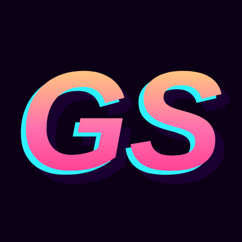
    </td>
  </tr>
</table>

---

## 📚 Índice
- [Links Úteis](#-links-úteis)
- [Sobre o Projeto](#-sobre-o-projeto)
- [Funcionalidades Principais](#-funcionalidades-principais)
- [Tecnologias Utilizadas](#-tecnologias-utilizadas)
- [Arquitetura](#-arquitetura)
- [Instalação e Execução](#-instalação-e-execução)
- [Deploy](#-deploy)
- [Estrutura de Pastas](#-estrutura-de-pastas)
- [Demonstração](#-demonstração)
- [Documentações utilizadas](#-documentações-utilizadas)
- [Autores](#-autores)
- [Agradecimentos](#-agradecimentos)
- [Licença](#-licença)

---

## 🔗 Links Úteis
- **Site publicado:** [portfolio-gus-corp1.vercel.app](https://portfolio-gus-corp1.vercel.app)
- **Repositório:** [github.com/vGustav1/portfolio](https://github.com/vGustav1/portfolio)

---

## 📝 Sobre o Projeto
Portfólio pessoal criado para apresentar minha trajetória, habilidades, projetos e formas de contato de forma moderna e acessível. Ele é a atividade avaliativa do Laboratório 01 e também serve como vitrine para processos seletivos de estágio, reunindo em um único link o que um recrutador precisa ver.

A identidade visual mistura neon dos anos 80 com objetos low-poly, e a seção de hobbies mostra dados reais de serviços que uso no dia a dia.

---

## ✨ Funcionalidades Principais
- **Sobre mim** em português e inglês, com troca de idioma no menu.
- **Projetos** em grid, com nome, descrição, tecnologias, link do GitHub e GIF do projeto funcionando.
- **Experiências** com instituição, cargo ou atividade, período e descrição.
- **Habilidades** em um sistema solar animado.
- **Hobbies** com dados ao vivo do Spotify, da Steam, do Chess.com e da IGDB.
- **Contato** com ícones clicáveis e formulário (nome, e-mail e mensagem) com envio por e-mail.
- **Design responsivo** para celular, tablet e desktop.

---

## 🛠 Tecnologias Utilizadas

### 💻 Front-end
- Next.js 16 (App Router)
- React 19
- TypeScript 5
- CSS puro com variáveis

### 🖥️ Back-end
- Rotas de servidor do Next.js (`app/api`)
- EmailJS para o envio do formulário
- APIs: Spotify, Steam, Chess.com e IGDB (Twitch)

### ⚙️ Infraestrutura & DevOps
- Vercel (hospedagem e deploy automático)
- Git e GitHub

### 📦 Dependências

| Pacote | Versão | Uso |
| --- | --- | --- |
| `next` | ^16.4.0 | Framework React |
| `react` / `react-dom` | ^19.3.0 | Interface |
| `@emailjs/browser` | ^5.0.3 | Envio do formulário |
| `typescript` | ^5.9.3 | Tipagem (desenvolvimento) |
| `@types/node`, `@types/react`, `@types/react-dom` | — | Tipos (desenvolvimento) |

---

## 🏗 Arquitetura
Aplicação Next.js de página única. A interface roda no navegador e busca os dados dos hobbies em rotas de servidor próprias, que chamam as APIs externas com as chaves guardadas em variáveis de ambiente. Assim, nenhuma chave fica exposta no navegador.

```
Navegador (React) ──► /api/spotify · /api/steam · /api/chess · /api/igdb ──► APIs externas
Formulário de contato ──► EmailJS ──► Gmail
```

Todo o conteúdo do site (textos, projetos e experiências) fica em `data/content.ts`. Se uma API estiver fora do ar, o card mostra dados de exemplo em vez de quebrar a página.

---

## 🔧 Instalação e Execução

### Pré-requisitos
- Node.js 20 ou superior
- npm
- Git

### 🔑 Variáveis de Ambiente
Copie o `.env.example` para `.env.local` e preencha. Todas são opcionais.

| Variável | Descrição |
| --- | --- |
| `NEXT_PUBLIC_EMAILJS_SERVICE_ID`, `NEXT_PUBLIC_EMAILJS_TEMPLATE_ID`, `NEXT_PUBLIC_EMAILJS_PUBLIC_KEY` | EmailJS |
| `CHESS_USERNAME` | Usuário do Chess.com |
| `STEAM_API_KEY`, `STEAM_ID` | Steam |
| `SPOTIFY_CLIENT_ID`, `SPOTIFY_CLIENT_SECRET`, `SPOTIFY_REFRESH_TOKEN` | Spotify |
| `TWITCH_CLIENT_ID`, `TWITCH_CLIENT_SECRET` | IGDB |

### 📦 Instalação de Dependências
```bash
git clone https://github.com/vGustav1/portfolio.git
cd portfolio
npm install
```

### ⚡ Como Executar a Aplicação
```bash
npm run dev
```
Acesse `http://localhost:3000`. Para gerar a versão de produção: `npm run build` e `npm run start`.

---

## 🚀 Deploy
O site está hospedado na Vercel, ligada a este repositório. As variáveis de ambiente ficam em **Settings → Environment Variables**, e cada `push` na branch `main` publica uma nova versão automaticamente.

---

## 📂 Estrutura de Pastas
```
.
├── app/
│   ├── api/            # rotas de servidor (Spotify, Steam, Chess.com, IGDB)
│   ├── globals.css     # estilos
│   ├── layout.tsx      # estrutura base e fontes
│   └── page.tsx        # página única
├── components/         # uma seção por arquivo
├── data/content.ts     # conteúdo do site (PT/EN)
├── lib/                # idiomas e tipos
├── public/             # imagens e GIFs
├── scripts/            # utilitários (token do Spotify, GIF da cidade)
└── docs/               # imagens do README
```

---

## 🎥 Demonstração

### 🧩 Wireframes (Figma)

| Início | Sobre mim |
| :---: | :---: |
| 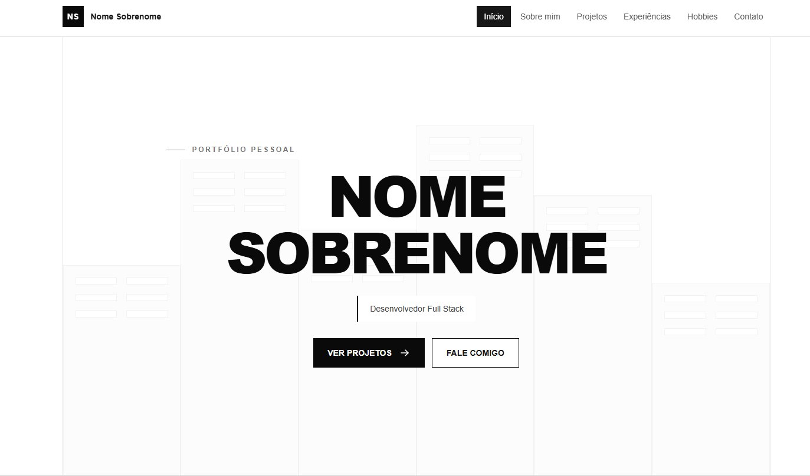 | 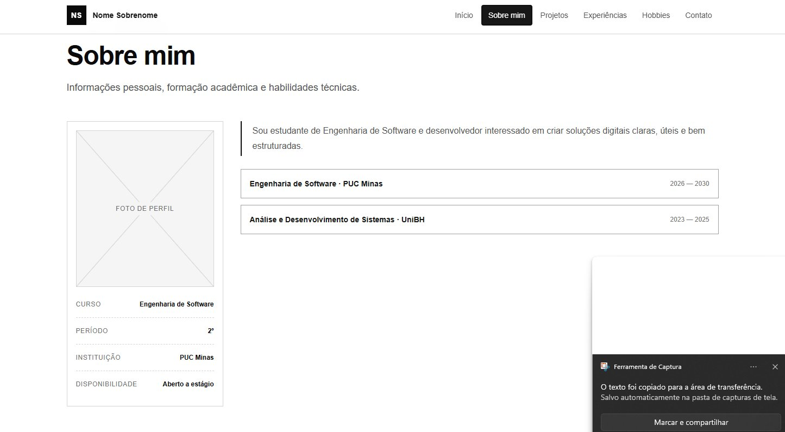 |
| **Projetos** | **Experiências** |
| 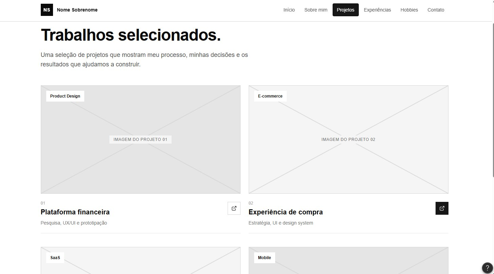 | 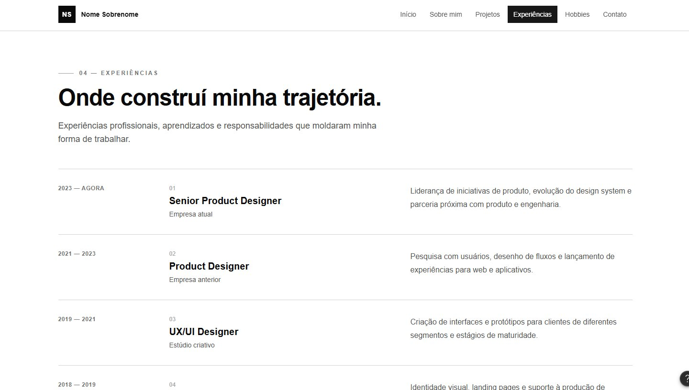 |
| **Hobbies** | **Contato** |
| 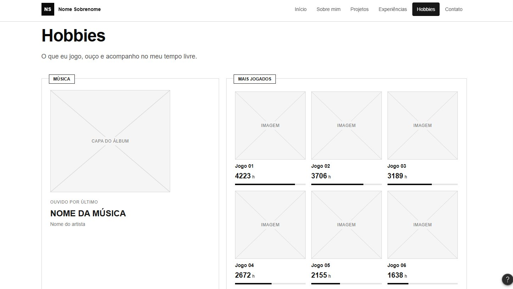 | 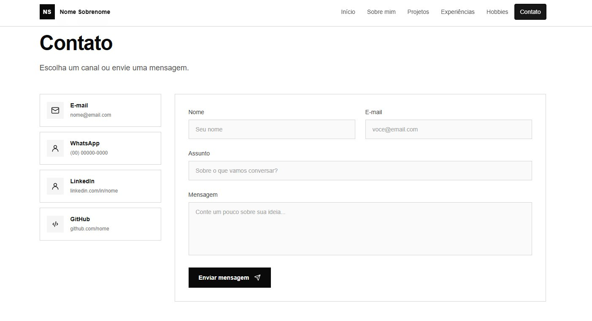 |

### 🌐 Aplicação Web

| Abertura | Sobre mim |
| :---: | :---: |
| 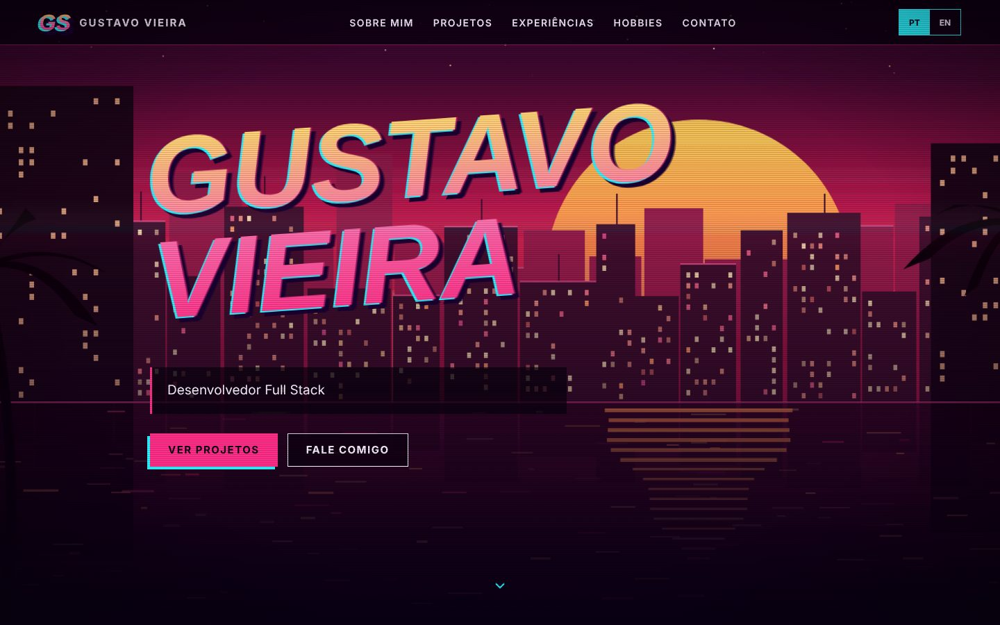 | 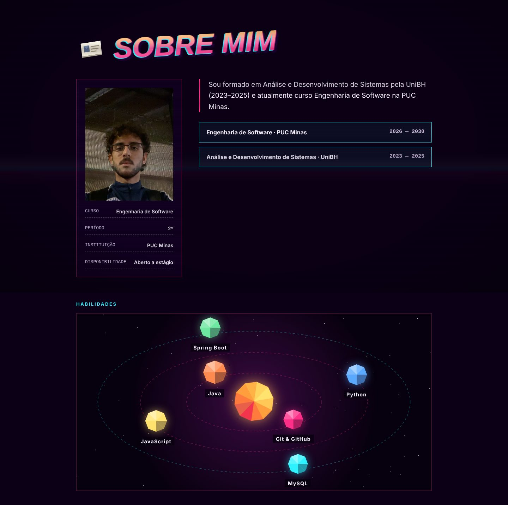 |
| **Projetos** | **Experiências** |
| 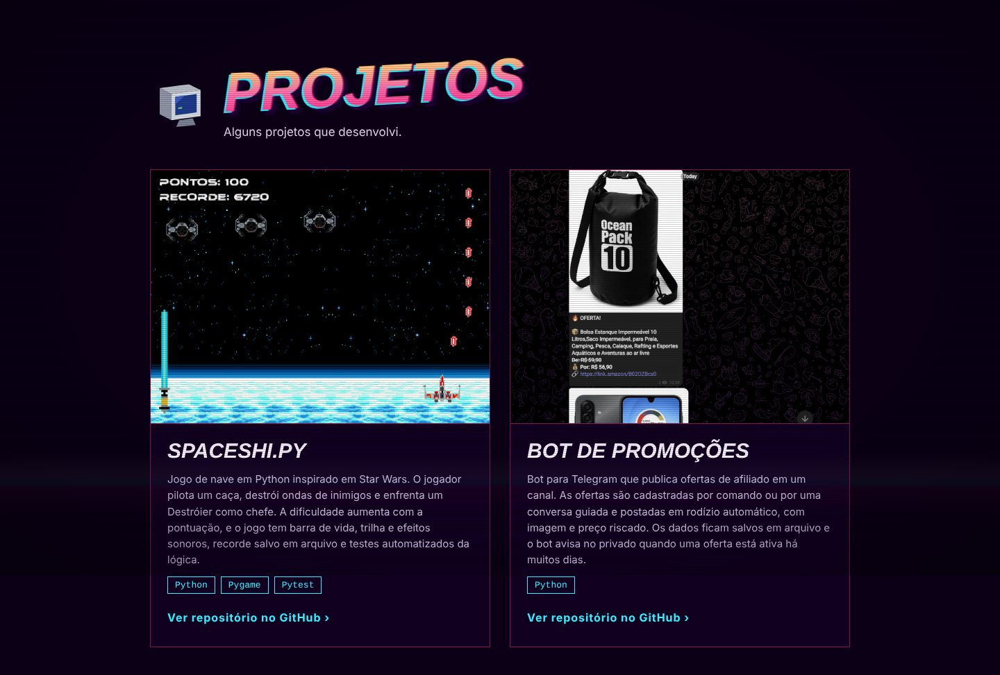 | 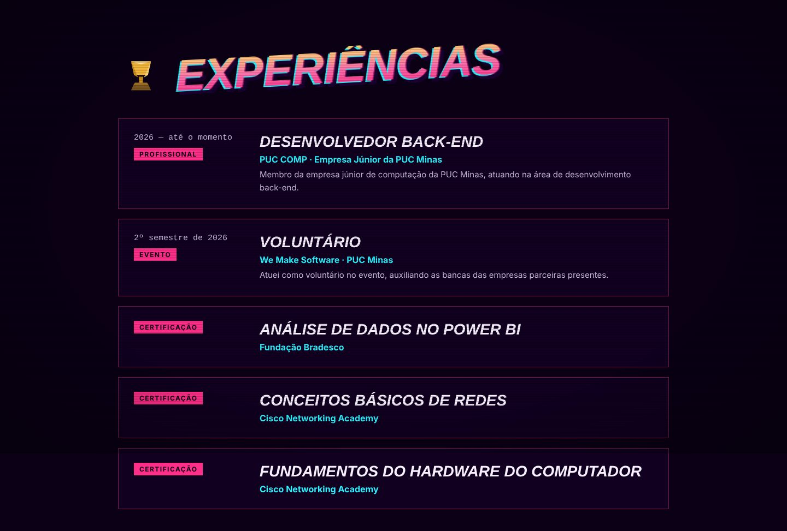 |
| **Contato** | **Celular** |
| 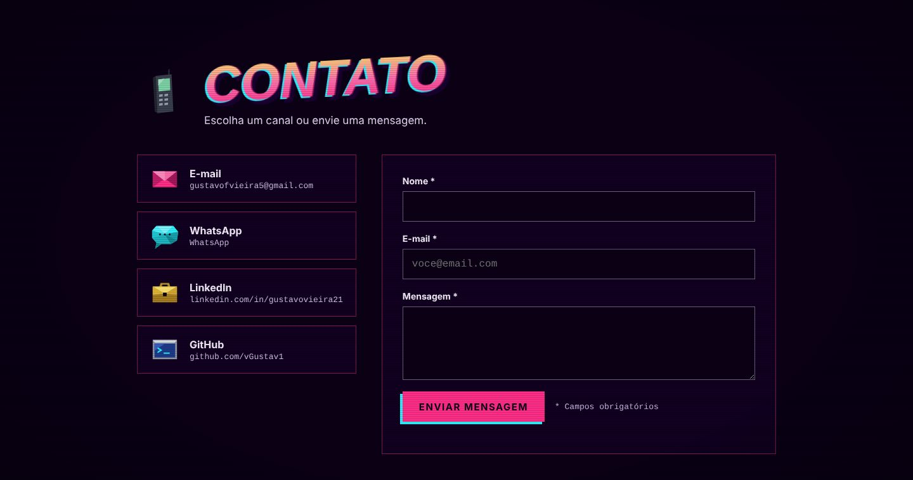 | 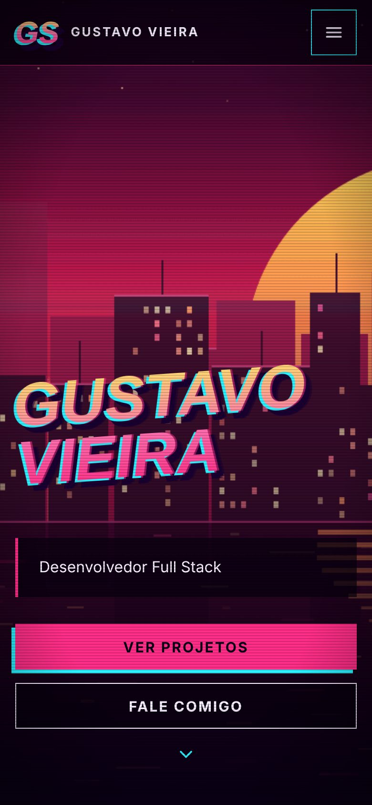 |

---

## 🔗 Documentações utilizadas
- [Next.js](https://nextjs.org/docs)
- [React](https://react.dev/reference/react)
- [EmailJS](https://www.emailjs.com/docs/)
- [Spotify Web API](https://developer.spotify.com/documentation/web-api)
- [Steam Web API](https://developer.valvesoftware.com/wiki/Steam_Web_API)
- [Chess.com Published-Data API](https://www.chess.com/news/view/published-data-api)
- [IGDB API](https://api-docs.igdb.com/)
- [Vercel](https://vercel.com/docs)

---

## 👥 Autores

| Nome | GitHub | LinkedIn | E-mail |
| --- | --- | --- | --- |
| Gustavo Vieira | [vGustav1](https://github.com/vGustav1) | [gustavovieira21](https://www.linkedin.com/in/gustavovieira21) | [gustavofvieira5@gmail.com](mailto:gustavofvieira5@gmail.com) |

---

## 🙏 Agradecimentos
- [Engenharia de Software PUC Minas](https://www.instagram.com/engsoftwarepucminas/), pelo apoio institucional.
- [Prof. Dr. João Paulo Aramuni](https://github.com/joaopauloaramuni), pela proposta do laboratório e pelo template deste README.

---

## 📄 Licença
Este projeto é distribuído sob a [Licença MIT](./LICENSE).
